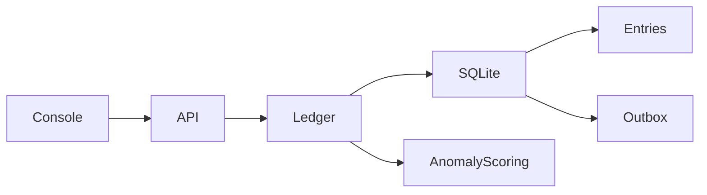

# Atlas Ledger

> Integridade financeira antes da inteligência

Retries de integração não podem duplicar dinheiro, e decisões de risco precisam ser explicáveis.

Projeto de portfólio executável, com dados sintéticos. Não representa um sistema em produção nem resultados de clientes.

## O que está implementado

Transferências atômicas; valores inteiros em centavos; partidas de soma zero; idempotência com hash de payload; proteção contra saldo negativo; outbox na mesma transação; isolamento por tenant; análise robusta de anomalias com mediana e MAD.

## Executar em cinco minutos

Requer Python 3.12 ou 3.13. Execute dentro desta pasta:

```powershell
python -m venv .venv
.venv\Scripts\Activate.ps1
python -m pip install -r requirements.txt
python -m uvicorn app.main:app --port 8101
```

Linux/macOS: ative com `source .venv/bin/activate`.
Abra http://localhost:8101 para a console e http://localhost:8101/docs para o contrato OpenAPI.
As chaves locais são `local-alpha` e `local-beta`, enviadas em `X-API-Key`.

### Demonstração

Crie treasury e merchant pela console, transfira e repita a mesma operação. O identificador permanece o mesmo. Altere o valor sem trocar a chave: a API retorna 409. Consulte o ledger para conferir saldos, partidas balanceadas e evento único.

### Testes

```bash
python -m pytest -q
```

Os testes usam bancos temporários. Verificam isolamento, autenticação, regras de domínio e cenários de falha.

### Docker

```bash
docker build -t atlas-ledger .
docker run --rm -p 8101:8101 atlas-ledger
```

O container usa usuário sem privilégios. O banco é efêmero nesse comando; monte um volume e configure DATABASE_PATH para persistência.

## Arquitetura



`app/main.py` define contratos HTTP; `app/service.py` contém casos de uso e transações;
o módulo de domínio contém o algoritmo; `app/platform.py` concentra autenticação e conexão.

Leia [decisões e tradeoffs](docs/architecture.md), [modelo e limites](docs/model-card.md),
[operação](docs/runbook.md) e [segurança](SECURITY.md).

## Limites conhecidos

Contas recebem um saldo inicial de laboratório; o projeto não implementa um plano contábil completo, múltiplas moedas, estornos, liquidação bancária ou reconciliação externa. A outbox é persistida, mas ainda não há dispatcher nem confirmação de entrega. O score MAD é um detector estatístico não supervisionado, não um modelo treinado de fraude. Ele sinaliza revisão e não bloqueia transferências.

## Próximos incrementos

Adicionar lançamentos de abertura e estorno imutáveis; migrar para PostgreSQL com bloqueio por conta; implementar dispatcher com leasing e consumidor idempotente; adicionar conciliação e avaliação com dados rotulados.

## Verificação em navegador

O job `browser` da CI executa fluxos em Chromium, verifica a versão de 390 px e publica capturas como artifact `dashboard-screenshots`. Execute `npm install` em `ui/`, `npx playwright install chromium` e `node ui/smoke.cjs` na raiz com a API em localhost:8000 para repetir.
